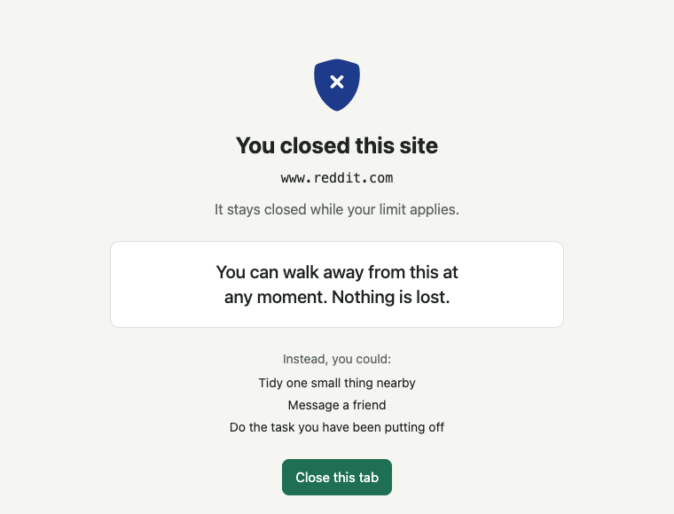
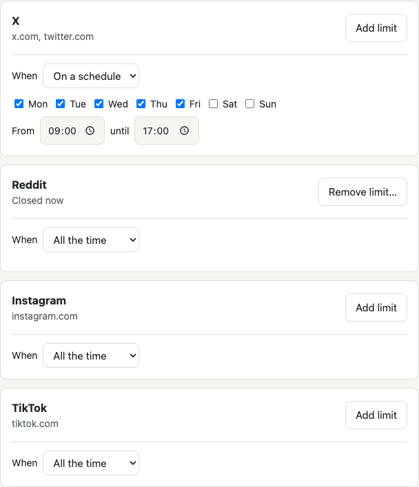

# Harmgate

A free, open-source Chrome extension that blocks pornography, gambling and gore sites, and lets you close the sites you waste time on. It runs entirely in your browser and collects no browsing data.



## What it does

**Core filter.** Blocks about 238,000 adult and gambling sites and a small list of gore sites from the moment you install it. It has no off switch. The lists refresh by themselves every week.

**Your limits.** Close X, Reddit, Instagram, TikTok or any other site, all the time or on a schedule. While a limit applies, the site is closed: there is no "continue" button and no "five more minutes". Tabs already open on the site are closed off too.

**Made to hold when you are tempted.** Adding a limit takes one click. Removing or loosening one takes a 5-minute wait with the tab in front, then a sentence typed by hand. The block page has no link to the settings.



## Install

Harmgate is not in the Chrome Web Store. [Install it from GitHub](docs/INSTALL.md) in about two minutes, using Chrome's developer mode.

## What it cannot do

- **It does not stop someone determined.** Anyone using the browser can remove Harmgate or turn off developer mode, which also turns Harmgate off. No extension can prevent that. It raises the effort of giving in. It is not a lock for a child's computer; the [roadmap](docs/ROADMAP.md) covers what browser policies may add.
- **It covers one browser profile.** Incognito windows are only covered if you turn that on, and the settings page tells you how. Other browsers and apps are not covered.
- **No list is complete.** New sites appear daily, and the gore list has only 23 sites so far.
- **It blocks whole sites.** It cannot filter what appears inside X or Reddit, only close them.
- **It sometimes blocks the wrong site.** Report it from the block page. You can also allow a single site in settings, after the same 5-minute wait.

It is tested in Chromium and Chrome. Edge and Brave are built on the same engine but have not been tested, and Firefox is not supported yet.

## Privacy

Your settings stay in your browser. The only requests Harmgate makes on its own go to GitHub, to check for newer lists and a newer version, and they contain nothing about your browsing. Read the [privacy note](docs/PRIVACY.md).

## Build it yourself

You need Node 24.

```bash
npm ci
npm run lists    # downloads the sources and builds the blocklists
npm run build    # writes the extension to dist/
npm test
npx playwright install chromium
npm run test:e2e
```

Then load `dist/` as an unpacked extension. The [roadmap](docs/ROADMAP.md) records the decisions behind the project and what comes next, and [`spike/RESULTS.md`](spike/RESULTS.md) has the measurements behind the blocking method.

## Contributing

The most useful help right now is reporting wrongly blocked sites, and harmful sites the lists miss. Open an [issue](https://github.com/keremcihansarac/harmgate/issues).

Issues are public. Never post a link to illegal content, such as child sexual abuse material. Report that to your national hotline, which you can find through [INHOPE](https://www.inhope.org).

To report a security problem, see [SECURITY.md](SECURITY.md).

## Disclaimer

Harmgate comes with no warranty, as set out in the [license](LICENSE). It does not catch everything and does not replace an adult's care for a child.

The blocklists come from third parties. A site being on them only means a list classed it that way. It is not a statement about the site or its owner, and wrong entries can be [reported](https://github.com/keremcihansarac/harmgate/issues).

Harmgate is an independent project, not affiliated with or endorsed by Google. Chrome and the other product names here are trademarks of their owners.

## License

[GPL-3.0](LICENSE). The blocklists come from other projects and keep their own licenses, listed in [THIRD_PARTY_NOTICES.md](THIRD_PARTY_NOTICES.md).
